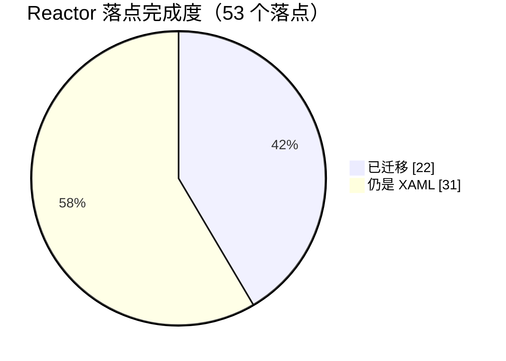

# 哔哩助理 · 自用重写版

> 个人自用的客户端源码存档。不分发安装包，也不面向普通用户发布。

## 先说清楚

- **原项目**：[Bili.Copilot](https://github.com/azpanel/Bili.Copilot)，作者**云之幻**。这个仓库是在原项目基础上给自己用的改造分支，界面骨架、播放内核、登录与数据接口很大一部分仍是原作者的工作。原作者没参与这个分支，这里的问题也不用去找原作者。
- **B 站版权**：视频、音频、封面、弹幕、评论等内容版权归哔哩哔哩及对应 UP 主、版权方所有。这个客户端只处理观看时的界面与播放，不提供内容下载分发，也不做付费内容破解。
- 仅供个人学习与自用，使用本仓库代码产生的后果与原项目作者、哔哩哔哩官方均无关。
- README 已替换成这份说明，因为代码改动已经很大，挂着原文容易被当成官方发布。

## 这个分支改了什么

### 播放结束页

播完之后不再停在“底栏还在、按播放键画面不动”的状态，而是整屏换成结束页：

- **触发**：位置进到片尾 0.3 秒内直接切；如果 mpv 停住的位置比时长差零点几秒，就靠一个 700ms 防抖——进入末两秒后位置不再推进也切。
- **底栏收起**，只留一根不可拖动的进度条；顶栏右侧那排（画质 / CDN / 空降 / AI 跳过 / 置顶 / 设置）一起隐藏。
- **一行排布**：左边 UP 头像、昵称、关注按钮；右边重播、好评、投币、收藏、分享。窗口窄到放不下时按钮组自动落到第二行，阈值是宽态下量出来的实际所需宽度，不是写死的数字。
- **互动按钮不另写一套**，直接复用视频信息面板的 `LikeButton` / `CoinButton` / `FavoriteButton`，状态、计数、三连、收藏夹列表都跟着同一个连接器走。
- **关注两态**：已关注显示对勾 +「已关注」，点一下真实取消并提示；未关注点了真实关注并提示。命令内部会吞异常，所以按“状态有没有变”判断成败，不会失败也报成功。
- **分享**：直接把 `https://www.bilibili.com/video/BV…` 写进剪贴板，播放窗口底部提示「已经复制视频链接，请自行粘贴」。
- **接着看**：先用播放器自身的推荐分区，没有就回退到 `IVideoDiscoveryService.GetRecommendVideoListAsync`，最多三列，随窗口宽度在一到三列之间变化，点卡片直接换视频。
- **重播**：`seek(0)` + `resume`，复用已经加载好的媒体；早先的实现走的是整条重载链路（重解析画质 / CDN / 字幕），实测会卡在「连接中」。

### 搜索结果页

顶栏和分区栏是 Reactor，视频卡片、排序、刷新仍是原 XAML 控件。搜索框居中、宽度和搜索首页那个一致，进来预填当前关键词；分区栏是 `SelectorBar`，选中项带下划线；窗口宽 ≥1000 DIP 时排序与刷新留在顶栏，窄了并进分区栏那一行。

### 其它界面改造

- **动态页**：综合动态换成响应式瀑布流，可用宽度 ≥900 DIP 两列、≥1250 DIP 三列；顶部关注 UP 头像条可按人筛选。
- **评论面板**：整块 Reactor 化，主评论与「N 条回复」共用一套卡片，排序、点赞、回复、加载更多都在。
- **顶栏与侧边栏**：搜索框居中，收藏 / 稍后再看 / 历史移到左侧，右侧只留窗口按钮；头像放进 PaneFooter，折叠态也能点搜索图标展开并聚焦搜索框。
- **搜索页背景**：右下角「编辑背景」，可导入 B 站主题装扮的 JSON（自动下装扮包、解出静态图与 mp4），也能直接传本地图片或视频；导入过的留在列表里带缩略图，叉号删除时连资源目录一起清掉，背景可以设成透明。

### 播放与内容能力

- **播放内核**：mpv 为主，WebView2 + Shaka 回落；mpv 初始化失败会自动降级。
- **画质解锁**：`Services/QualityUnlockService`，按 `avid` / `cid` / `fn=0` 走 wbi 签名调 `ogv/player/playview`（`api/bzview3`），失败就退回常规地址，不阻塞播放。
- **CDN 优选**：节点池同步自外部 `cdn.json`，右上角和右键菜单都能手动指定或自动优选。
- **直播**：右侧互动面板响应式（展开时播放器让位）；弹幕走自研 WebSocket 通道；底栏漏斗可按「等级 < 3」「没有粉丝牌」过滤普通弹幕，礼物、醒目留言、上舰、进场不受影响。
- **空降助手**：SponsorBlock 兼容服务 + 跳转点数据 + AI 识别三层叠加，默认自动跳过，可切手动（左下角药丸按钮），静音类片段压低音量而不是跳过。
- **AI**：设置页集中配接口地址、模型、密钥，带保存 / 测试接口 / 测试模型；另有按动态「已看过」栏做的观看兴趣分析。

### 顺手修掉的

- **动态页顶部 UP 头像条**点了没反应：`OnControlLoaded` 在 ViewModel 还是 null 时直接解引用，空引用把后面挂 `SelectionChanged` 的代码整段挡掉；现在订阅拆成 Attach/Detach。
- **收藏 / 稍后再看 / 历史记录的返回键**要按好几次：`OverlayFrame.NavigateTo` 是往栈里加页，两个列表长得像，看着像没动；现在这三个入口页点返回直接清栈退出。
- **评论回复按钮**点了没反应：命中区放大、命令创建时绑定，点完把 `@用户名 ` 写进输入框并抢焦点。
- **搜索结果页切分区不生效**：给 `SelectorBar` 传固定 `selectedIndex` 等于受控模式，点击被立刻改回；内容宿主又没 key，旧分区还留在树上。改成 `Optional<int>.Unset` + 内容宿主按分区类型加 key。
- **搜索框建议浮层**是 Popup，跳结果页后仍浮在最上层吃掉点击；结果页那个实例直接摘掉 `ItemsSource` 并每次渲染压一遍。
- **视频标签点击**：原来 `SearchCommand.Execute(string)` 触发参数类型异常（命令签名是 `IAsyncRelayCommand<SearchSuggestItemViewModel>`），改成走 `NavigationViewModel.Search(tag.Name)`。

## 代码规模与 Reactor 进度

口径是 `git ls-files` 那批文件里的实际行数，排除 `obj` / `bin` / `_build`，**按钮控件单独算进 XAML**（`LikeButton` / `CoinButton` / `FavoriteButton` / `DownloadButton` / `CommentLikeButton` 五个，共 262 行）。

| 分类 | 文件 | 行数 |
| --- | ---: | ---: |
| XAML（含 5 个按钮控件 262 行） | 239 | 18,475 |
| XAML 后台代码（`.xaml.cs`） | 228 | 11,703 |
| Reactor 外壳（`Reactor/*.cs`） | 16 | 4,207 |
| 全部 C# | 623 | 52,948 |

比例：

| 对比 | 计算 | 结果 |
| --- | --- | ---: |
| Reactor / XAML | 4,207 ÷ 18,475 | **22.8%** |
| Reactor / 界面层（XAML + 后台） | 4,207 ÷ 30,178 | **13.9%** |
| Reactor / 全部 C# | 4,207 ÷ 52,948 | **7.9%** |

也就是：界面层三成代码已经搬到 Reactor，换成“界面 + 后台”一起看是一成四。

按「界面落点」数（外壳算 1；每页算 1；播放页每个侧栏面板、评论 / 弹幕 / 直播互动面板、视频卡片布局、设置卡片、播放器控制层各算 1；样式模板图标不算）：



| 区域 | 已迁移 | 总数 | 进度 |
| --- | :---: | :---: | --- |
| 应用外壳（窗口 / 导航 / 标题栏 / 侧边栏 / 账号） | 1 | 1 | `██████████` 100% |
| 页面 | 12 | 21 | `██████░░░░` 57% |
| 播放页侧栏（视频信息 / 分 P / 合集 / 播放列表） | 4 | 4 | `██████████` 100% |
| 评论 / 弹幕 / 直播互动面板 | 3 | 4 | `███████░░░` 75% |
| 视频卡片布局（推荐流 / 动态） | 2 | 2 | `██████████` 100% |
| 设置卡片 | 0 | 20 | `░░░░░░░░░░` 0% |
| 播放器控制层（控制栏 / 右键菜单 / 进度条 / 浮层 / 结束页） | 0 | 1 整块 | `░░░░░░░░░░` 0% |

合计 **22 / 53 ≈ 42%**。

另有 **37 个 XAML 文件已经退化成 20 行以内的宿主壳**——只剩一个容器，内容全在 Reactor 那边（`MomentPage.xaml` 11 行、`SearchPage.xaml` 12 行、`MainWindow.xaml` 14 行这样）。仓库里共 21 个页面、211 个控件。

**已挂 Reactor 外壳的 12 个页面**：动态、消息、直播分区、历史、收藏、稍后再看、设置、流行、视频分区、动漫、影视、搜索结果。

**仍是纯 XAML 的页面**：启动页、图库、搜索首页（带背景装扮的那个）、文章分区、文章阅读、个人空间、关注、粉丝。

**刻意没动的**：

- 20 个设置卡片：图标、描述、右侧操作区的排版由 `SettingsCard` / `SettingsExpander` 自己管，复刻容易走样。
- 播放器控制层整块：控制栏、右键菜单、右上角按钮组、字幕与着色器面板、直播弹幕浮层，再加上这次的结束页（`PlaybackEndPanel.xaml` 196 行 + 后台 88 行 + `PlayerViewModel.EndScreen.cs` 303 行）。这块和播放器生命周期强绑定，下一轮再啃。

## 技术栈

- .NET 10 / C# / WinUI 3（Windows App SDK 2.6.5），目标框架 `net10.0-windows10.0.22621.0`
- Microsoft.UI.Reactor 0.1.0-preview.17
- CommunityToolkit.Mvvm 8.2.2（`[ObservableProperty]` / `[RelayCommand]`）
- BiliKernel（原项目的数据与接口层）
- mpv（Richasy.MpvKernel）

## 构建（Windows）

```powershell
git clone https://github.com/TravelLeobai/Bili.Copilot.git
cd Bili.Copilot/src
dotnet build Desktop\BiliCopilot.UI\BiliCopilot.UI.csproj -c Debug -p:Platform=x64
```

需要 Windows 11、.NET 10 SDK，以及 **Windows App Runtime 2.6**（去 [Windows App SDK 下载页](https://learn.microsoft.com/windows/apps/windows-app-sdk/downloads) 装对应版本；也可以把项目改成自包含部署）。版本号在 `src/Directory.Packages.props` 的 `Microsoft.WindowsAppSDK`。第一次运行会走原项目的登录流程，登录态与缓存都留在本机用户目录。

几个踩过的构建坑：

- 改完代码遇到 `MSB3027`（文件被占用）：先结束 `BiliCopilot.UI` / `MSBuild` / `VBCSCompiler`，等十来秒再编。
- XAML 编译偶发 PRI 报错：删掉 `_build\x64\Debug\BiliCopilot.UI\bin\resources.pri` 重来。
- 想发 Release 又不需要 AOT：加 `-p:PublishAot=false`，否则会撞 `Platform linker not found`。

## 配置与密钥

仓库里不含任何接口密钥、Cookie 或账号凭据。AI 接口、模型、密钥、SponsorBlock 服务器地址这些都在应用设置页里填，只写到本机 `LocalSettings`，不会进版本库。想用空降助手的 AI 识别，需要自己填一个兼容 OpenAI 协议的接口。

## 已知问题

- **设置文件损坏会导致启动即崩**：症状是启动约十秒后进程消失，事件日志里是 `combase.dll` + `0x80004003`（`E_POINTER`），日志停在 `Visor initialized successfully` 之后。用同一份代码重编也照样崩，隔离设置文件就正常。治法：退出应用，删掉
  `%LOCALAPPDATA%\Packages\Richasy.BiliCopilot.Dev_g7ew4fxhv1f46\Settings\settings.dat`，代价是登录态和偏好重置，需要重新扫码。删之前先备份一份。
- **`DefaultStyleOptimizations` 实验开关默认关闭**：WinUI 自带的控件样式优化开关，走 `AppContext.SetSwitch`，本机实测打开后启动不稳，所以先关掉，代码里留了注释。
- **画质解锁有额度**：走第三方登记服务，额度用完会返回 `code=9`，此时自动退回常规地址，不影响播放。

## 许可

沿用原项目的 LICENSE。代码可读可学，但要拿去发布、改名上架或商用之前，请先满足原项目的许可条件并取得哔哩哔哩相关授权——这不是本仓库能替你解决的事。

---

给云之幻：谢谢你写的 Bili.Copilot，没有它这个分支无从谈起。
