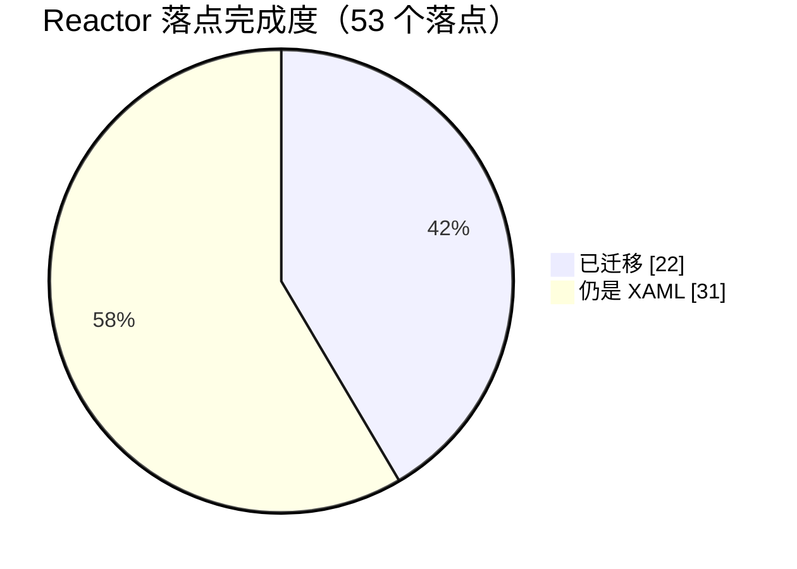

# 哔哩助理 · 自用重写版

> 个人自用的客户端源码存档。不分发安装包，也不面向普通用户发布。

## 先说清楚

- **原项目**：[Bili.Copilot](https://github.com/azpanel/Bili.Copilot)，作者**云之幻**。这个仓库是在原项目基础上给自己用的改造分支，界面骨架、播放内核、登录与数据接口很大一部分仍是原作者的工作。原作者没参与这个分支，这里的问题也不用去找原作者。
- **B 站版权**：视频、音频、封面、弹幕、评论等内容版权归哔哩哔哩及对应 UP 主、版权方所有。这个客户端只处理观看时的界面与播放，不提供内容下载分发，也不做付费内容破解。
- 仅供个人学习与自用，使用本仓库代码产生的后果与原项目作者、哔哩哔哩官方均无关。
- README 已替换成这份说明，因为代码改动已经很大，挂着原文容易被当成官方发布。

## 这个分支改了什么

界面层用 **Microsoft.UI.Reactor** 声明式重写，改的是自用场景里最碍事的几块：

- **动态页**：综合动态换成响应式瀑布流，可用宽度 ≥900 DIP 两列、≥1250 DIP 三列，卡片间距统一；顶部关注 UP 头像条可按人筛选。
- **评论面板**：整块 Reactor 化，主评论与「N 条回复」共用同一套卡片，排序、点赞、回复、加载更多都在。
- **搜索结果页**：顶栏和分区栏交给 Reactor，视频卡片、排序按钮、刷新按钮仍是原 XAML 控件。顶栏搜索框居中、宽度和搜索首页那个框一致，进来预填当前关键词、点一下清空；分区栏是 `SelectorBar`，横向排在顶栏下面，选中项带下划线。
- **顶栏**：搜索框居中，收藏 / 稍后再看 / 历史移到左侧，右侧只留窗口按钮。
- **侧边栏**：头像放进 PaneFooter，收起时退到左侧窄条；折叠态也能点搜索图标展开并聚焦搜索框。
- **播放页**：mpv 为主播放内核，另有 WebView2 回落；CDN 节点可手动指定或自动优选，播放界面右侧和右键菜单都能切。
- **搜索页背景**：右下角有「编辑背景」按钮。可以导入 B 站主题装扮的 JSON（自动下载装扮包，解出静态图和 mp4），也可以直接传本地图片或本地视频；导入过的会留在列表里带缩略图，选中即生效，叉号删除时把资源目录一起清掉。背景还能设成透明。面板右下角有个「获取装扮」链接，指向收集装扮的 Telegram 频道。
- **直播**：右侧互动面板做成响应式——展开时播放器让位、收起时只留一根展开箭头；直播弹幕走自研 WebSocket 通道，发送走服务端接口并解析返回码；「回到最新」只出现在进度条右侧。
- **直播弹幕过滤**：底栏漏斗按钮，可以按「B 站等级小于 3 的用户」「没有粉丝牌的用户」过滤普通弹幕，开关写本地设置。礼物、醒目留言、上舰、进场这些不受影响——它们本来大多没有粉丝牌，一起过滤会丢信息。
- **空降助手**：接 SponsorBlock 兼容服务（前缀哈希接口 + videoID 查询，多服务器依次尝试），再叠一层跳转点数据源和 AI 识别。默认自动跳过，也可以切成手动，手动时左下角弹一个药丸按钮，点一下跳到片段末尾。识别结果按分类过滤，静音类片段改为压低音量而不是跳过。
- **设置页**：AI 接口地址、模型、密钥集中在一处，带保存、测试接口、测试模型。设置卡片统一用 XAML 的 `SettingsCard` / `SettingsExpander`，每张卡都有图标。

## 顺手修掉的

- **动态页顶部 UP 头像条**：以前点了完全没反应。`VideoMomentSectionDetailControl.OnControlLoaded` 在 ViewModel 还是 null 时直接解引用，抛了空引用，把后面给头像条挂 `SelectionChanged` 的代码整段挡掉。现在订阅拆成 Attach/Detach，ViewModel 到位时补挂。
- **收藏 / 稍后再看 / 历史记录 的返回键**：以前要按好几次才退得出去。`OverlayFrame.NavigateTo` 是往栈里加页，先进收藏再点历史，栈里就两页，返回一次只是换回上一个列表——两个列表长得像，看着像没动。现在这三个抽屉入口页点返回直接清栈退出，其它浮层页仍按层级回退。
- **评论回复按钮"点了没反应"**：命中区放大到 36×32，命令在创建时就绑上；点完把 `@用户名 ` 直接写进输入框并抢焦点，不再只靠输入框上方那行小字提示。同一个人连点两次也会因为版本号变化而重新触发。
- **回复视图的返回按钮**：左边距 12，与评论卡片的 `Margin(12,4,12,4)` 对齐，箭头左缘与卡片左缘齐平。
- **搜索结果页切分区不生效**：两个原因叠在一起——给 `SelectorBar` 传了固定 `selectedIndex` 等于受控模式，点击会被立刻改回原值；内容宿主没有 key，旧分区控件还留在树上。改成 `Optional<int>.Unset` + 内容宿主按分区类型加 key。
- **搜索框的建议浮层**：它是 Popup，跳到结果页后仍浮在最上层，会把分区栏的点击吃掉。结果页那个实例直接摘掉 `ItemsSource`，并在每次渲染时压一遍。

## Reactor 替换 XAML 的进度

界面正在从 XAML 迁到 Reactor，没迁完，下面是按代码实测的口径，不是估计。

**口径**：按「界面落点」数——应用外壳算 1 个；每个页面算 1 个；播放页的每个侧栏面板、评论 / 弹幕 / 直播互动面板、每套视频卡片布局、每张设置卡片各算 1 个；播放器控制层整块算 1 个。样式、模板、图标不算落点。



| 区域 | 已迁移 | 总数 | 进度 |
| --- | :---: | :---: | --- |
| 应用外壳（窗口 / 导航 / 标题栏 / 侧边栏 / 账号） | 1 | 1 | `██████████` 100% |
| 页面 | 12 | 21 | `██████░░░░` 57% |
| 播放页侧栏（视频信息 / 分 P / 合集 / 播放列表） | 4 | 4 | `██████████` 100% |
| 评论 / 弹幕 / 直播互动面板 | 3 | 4 | `███████░░░` 75% |
| 视频卡片布局（推荐流 / 动态） | 2 | 2 | `██████████` 100% |
| 设置卡片 | 0 | 20 | `░░░░░░░░░░` 0% |
| 播放器控制层（控制栏 / 右键菜单 / 进度条 / 各种浮层） | 0 | 1 整块 | `░░░░░░░░░░` 0% |

合计 **22 / 53 ≈ 42%**。

代码量对照（2026-11 实测）：XAML 还有 **238 个文件、18268 行**；Reactor 是 **16 个文件、4176 行**。已经有 **37 个 XAML 文件退化成 20 行以内的宿主壳**——只剩一个容器，内容全在 Reactor 那边。

**已经挂上 Reactor 外壳的 12 个页面**：动态、消息、直播分区、历史、收藏、稍后再看、设置、流行、视频分区、动漫、影视、搜索结果。

**仍是纯 XAML 的页面**（8 个）：启动页、图库、搜索首页（带背景装扮的那个）、文章分区、文章阅读、个人空间、关注、粉丝。

**其它没动的**

- 20 个设置卡片（刻意留在 XAML：图标、描述、右侧操作区的排版由 `SettingsCard` 自己管，自己复刻反而容易走样）
- 播放器控制层整块：控制栏、右键菜单、右上角按钮组、字幕与着色器面板、直播弹幕浮层

下一步先啃播放器控制层——它是最后一大块跟播放器生命周期强绑定的 XAML，改完播放页才算整体换完。

## 技术栈

- .NET 10 / C# / WinUI 3（Windows App SDK 2.6.5）
- Microsoft.UI.Reactor 0.1.0-preview.17
- BiliKernel（原项目的数据与接口层）
- mpv（Richasy.MpvKernel）

## 构建（Windows）

```powershell
git clone https://github.com/TravelLeobai/Bili.Copilot.git
cd Bili.Copilot/src
dotnet build Desktop\BiliCopilot.UI\BiliCopilot.UI.csproj -c Debug -p:Platform=x64
```

需要 Windows 11、.NET 10 SDK，以及 **Windows App Runtime 2.6**（去 [Windows App SDK 下载页](https://learn.microsoft.com/windows/apps/windows-app-sdk/downloads) 装对应版本；也可以把项目改成自包含部署）。版本号在 `src/Directory.Packages.props` 的 `Microsoft.WindowsAppSDK`。第一次运行会走原项目的登录流程，登录态与缓存都留在本机用户目录。

改完代码如果遇到 `MSB3027`（文件被占用），先结束 `BiliCopilot.UI` / `MSBuild` / `VBCSCompiler` 再等十来秒重编；XAML 编译偶发 PRI 错误时，删掉 `_build\x64\Debug\BiliCopilot.UI\bin\resources.pri` 重来。

## 配置与密钥

仓库里不含任何接口密钥、Cookie 或账号凭据。AI 接口、模型、密钥、SponsorBlock 服务器地址这些都在应用设置页里填，只写到本机 `LocalSettings`，不会进版本库。想用空降助手的 AI 识别，需要自己填一个兼容 OpenAI 协议的接口。

## 已知问题

- **设置文件损坏会导致启动即崩**：症状是启动约十秒后进程消失，事件日志里是 `combase.dll` + `0x80004003`（`E_POINTER`），日志停在 `Visor initialized successfully` 之后。用同一份代码重编也照样崩，隔离设置文件就正常。治法：退出应用，删掉
  `%LOCALAPPDATA%\Packages\Richasy.BiliCopilot.Dev_g7ew4fxhv1f46\Settings\settings.dat`，代价是登录态和偏好重置，需要重新扫码。删之前先备份一份，万一以后能定位到具体字段。
- **`DefaultStyleOptimizations` 实验开关默认关闭**：它是 WinUI 自带的控件样式优化开关，走 `AppContext.SetSwitch`，本机实测打开后启动行为不稳，所以先关掉，代码里留了注释。

## 许可

沿用原项目的 LICENSE。代码可读可学，但要拿去发布、改名上架或商用之前，请先满足原项目的许可条件并取得哔哩哔哩相关授权——这不是本仓库能替你解决的事。

---

给云之幻：谢谢你写的 Bili.Copilot，没有它这个分支无从谈起。
