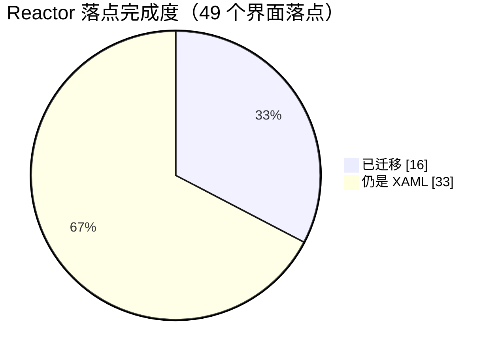

# 哔哩助理 · 自用重写版

> 个人自用的客户端源码存档。不分发安装包，也不面向普通用户发布。

## 先说清楚

- **原项目**：[Bili.Copilot](https://github.com/azpanel/Bili.Copilot)，作者**云之幻**。这个仓库是在原项目基础上给自己用的改造分支，界面骨架、播放内核、登录与数据接口很大一部分仍是原作者的工作。原作者没参与这个分支，这里的问题也不用去找原作者。
- **B 站版权**：视频、音频、封面、弹幕、评论等内容版权归哔哩哔哩及对应 UP 主、版权方所有。这个客户端只处理观看时的界面与播放，不提供内容下载分发，也不做付费内容破解。
- 仅供个人学习与自用，使用本仓库代码产生的后果与原项目作者、哔哩哔哩官方均无关。
- 原 README 已替换成这份说明，因为代码改动已经很大，挂着原文容易被当成官方发布。

## 这个分支改了什么

界面层用 **Microsoft.UI.Reactor** 声明式重写，改的是自用场景里最碍事的几块：

- **动态页**：综合动态换成响应式瀑布流，可用宽度 ≥900 DIP 两列、≥1250 DIP 三列，卡片间距统一；顶部关注 UP 头像条可按人筛选。
- **评论面板**：整块 Reactor 化，主评论与「N 条回复」共用同一套卡片，排序、点赞、回复、加载更多都在。
- **顶栏**：搜索框居中，收藏 / 稍后再看 / 历史移到左侧，右侧只留窗口按钮。
- **侧边栏**：头像放进 PaneFooter，收起时退到左侧窄条；折叠态也能点搜索图标展开并聚焦搜索框。
- **播放页**：mpv 为主播放内核，另有 WebView2 回落；CDN 节点可手动指定或自动优选，播放界面右侧和右键菜单都能切。
- **直播**：右侧互动面板做成响应式——展开时播放器让位、收起时只留一根展开箭头；直播弹幕走自研 WebSocket 通道，发送走服务端接口并解析返回码；「回到最新」只出现在进度条右侧。
- **空降助手**：接 SponsorBlock 兼容服务（前缀哈希接口 + videoID 查询，多服务器依次尝试），再叠一层 AI 识别。默认自动跳过，也可以切成手动，手动时左下角弹一个药丸按钮，点一下跳到片段末尾。识别结果按分类过滤，静音类片段改为压低音量而不是跳过。
- **设置页**：AI 接口地址、模型、密钥集中在一处，带保存、测试接口、测试模型。

## Reactor 替换 XAML 的进度

界面正在从 XAML 迁到 Microsoft.UI.Reactor，没迁完，这张表和图上的是当前实际状态。

**口径**：按「界面落点」数——独立页面、播放页的每个侧栏面板、评论与弹幕面板、每张设置卡片、每套视频卡片布局，各算一个。样式、模板、图标这类不算落点。



| 区域 | 已迁移 | 总数 | 进度 |
| --- | :---: | :---: | --- |
| 应用外壳（窗口 / 导航 / 标题栏 / 侧边栏 / 账号） | 1 | 1 | `██████████` 100% |
| 页面骨架 | 7 | 20 | `███░░░░░░░` 35% |
| 播放页侧栏（视频信息 / 分 P / 合集 / 播放列表） | 4 | 4 | `██████████` 100% |
| 评论与弹幕面板 | 3 | 4 | `███████░░░` 75% |
| 视频卡片布局（推荐流 / 动态） | 2 | 2 | `██████████` 100% |
| 设置卡片 | 0 | 20 | `░░░░░░░░░░` 0% |
| 播放器控制层（控制栏 / 右键菜单 / 进度条 / 各种浮层） | 0 | 35 个 XAML | `░░░░░░░░░░` 0% |

合计 **16 / 49 ≈ 33%**。

代码量的对照：XAML 还有 241 个文件、18238 行；Reactor 是 13 个文件、2948 行。已经有 22 个 XAML 文件退化成 10–14 行的宿主壳——只剩一个容器，内容全在 Reactor 那边。

**已迁移的**

- 主窗口与外壳：`MainShell`（导航、搜索框、标题栏内容、账号区）
- 7 个页面：动态、消息、直播分区、历史、收藏、稍后再看、设置
- 播放页右侧 4 个面板、评论面板、视频弹幕面板、直播互动面板
- 视频卡片两套布局，以及动态页瀑布流

**还没动的**

- 12 个页面仍是 XAML：流行、视频分区、番剧、影视、文章分区、启动页、图库、搜索、个人空间、粉丝、关注、文章阅读
- 20 个设置卡片
- 播放器控制层整块：控制栏、右键菜单、右上角按钮组、字幕与着色器面板、直播弹幕浮层

按眼下的节奏，下一步先啃播放器控制层——它是最后一大块跟播放器生命周期强绑定的 XAML，改完播放页才算整体换完。

## 技术栈

- .NET 10 / C# / WinUI 3（Windows App SDK 2.2）
- Microsoft.UI.Reactor
- BiliKernel（原项目的数据与接口层）
- mpv（Richasy.MpvKernel）

## 构建（Windows）

```powershell
git clone https://github.com/TravelLeobai/Bili.Copilot.git
cd Bili.Copilot/src
dotnet build Desktop\BiliCopilot.UI\BiliCopilot.UI.csproj -c Debug -p:Platform=x64
```

需要 Windows 11、.NET 10 SDK 和 Windows App SDK 运行时。第一次运行会走原项目的登录流程，登录态与缓存都留在本机用户目录。

## 配置与密钥

仓库里不含任何接口密钥、Cookie 或账号凭据。AI 接口、模型、密钥、SponsorBlock 服务器地址这些都在应用设置页里填，只写到本机 `LocalSettings`，不会进版本库。想用空降助手的 AI 识别，需要自己填一个兼容 OpenAI 协议的接口。

## 许可

沿用原项目的 LICENSE。代码可读可学，但要拿去发布、改名上架或商用之前，请先满足原项目的许可条件并取得哔哩哔哩相关授权——这不是本仓库能替你解决的事。

---

给云之幻：谢谢你写的 Bili.Copilot，没有它这个分支无从谈起。
